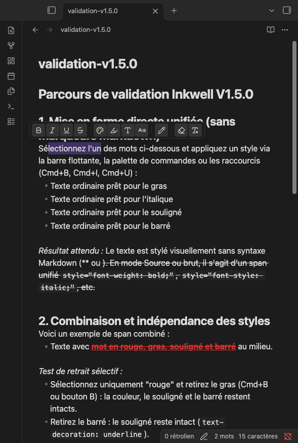
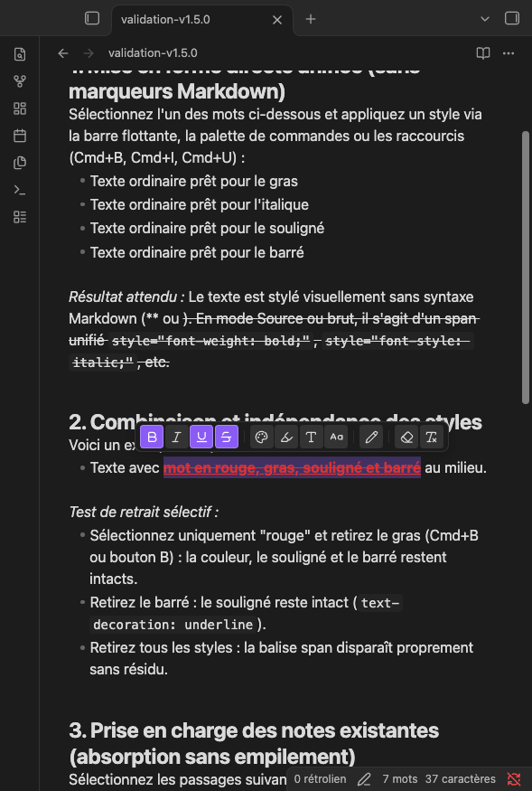

# Inkwell

**Visual inline styling and formatting for Obsidian.**

Color, highlight, resize, style typography, and format text with a clean contextual floating toolbar. Inkwell stores all inline formatting as standard HTML `<span>` tags directly in your Markdown notes, keeping your notes readable and styled everywhere.



---

## Features

### 1. Unified Inline Formatting (Zero Markdown Delimiter Clutter)
* **Bold** (`font-weight: bold;`)
* **Italic** (`font-style: italic;`)
* **Underline** (`text-decoration: underline;`)
* **Strikethrough** (`text-decoration: line-through;`)
* **Combined decorations** (e.g. `underline line-through;`)
* **No asterisks or tildes**: Inkwell commands and shortcuts never generate `**`, `*`, or `~~`. All inline styles live inside a consolidated, clean HTML span.
* **Independent style removal**: Remove bold from a word without stripping its color, size, or underline. When all styles are removed, the span tag is automatically and cleanly deleted.

### 2. Compact Floating Selection Toolbar
Appears automatically above selected text in **Live Preview** (desktop and mobile), organized into 4 logical groups:
* **Group 1: Basic Typography** — Bold (`Mod+B`), Italic (`Mod+I`), Underline (`Mod+U`), Strikethrough.
* **Group 2: Rich Styling** — Text Color, Custom Highlight, Font Size & Headings, Font Family.
* **Group 3: Content Editing** — Quick text edit modal to alter text without breaking tags.
* **Group 4: Cleanup Tools** — Targeted cleanup menu (remove color, remove highlight) + 1-click global clear formatting button.
* **Accessible States**: Active styles feature a solid accent fill, while mixed styles (partial selections) display a distinct inset border and a textured dotted indicator.



### 3. Rich Colors & Custom Highlight Appearance
* **Curated 8-Color Palette** + custom hex color picker with live contrast ratio preview against your current theme.
* **Custom Highlight Appearance**: Configure highlight opacity, border corner radius ($0\text{ to }12\text{ px}$), line height thickness ($15\%\text{ to }100\%$), and vertical offset position.

### 4. Typography & Font Sizes
* **Font Sizes**: Relative presets (*Small* `0.85em`, *Normal*, *Large* `1.25em`) and absolute point sizes ($4\text{ to }144\text{ pt}$, Word-style).
* **Headings Helper**: Quick switch between Normal text and Markdown headings ($H1\text{ to }H6$).
* **Font Families**: Standard generic families (`sans-serif`, `serif`, `monospace`) and personal font import (`.ttf`, `.otf`, `.woff`, `.woff2`) loaded locally into your vault.

### 5. Seamless Masking & Transparent Editing
* Balises and raw HTML code are hidden in both **Live Preview** and **Source Mode**.
* Free character-by-character caret navigation and selection.
* Natural typing, Backspace/Delete across span boundaries, Enter to split spans across lines, and atomic undo/redo (`Mod+Z`).
* Markdown structures (headings, lists, checkboxes, tables, code blocks) and code syntax are strictly preserved and never altered.

---

## How Inkwell Stores Formatting

Inkwell records all inline formatting directly in the Markdown text using standard HTML tags:

```html
<span data-inkwell="1" style="color: #e03131; font-weight: bold; text-decoration: underline;">styled text</span>
```

### Why HTML Spans?
Standard Markdown syntax (`**`, `*`, `~~`) does not support text colors, custom background highlights, font sizes, or font families. Rather than introducing proprietary or non-standard Markdown syntax that would break other tools, Inkwell uses standard HTML5 inline spans recognized by all modern HTML and Markdown renderers.

### What Happens Without Inkwell?
* **In Obsidian (if plugin is disabled)**: Obsidian's native Markdown renderer supports inline HTML. Your formatted text will still render correctly in Reading View and Live Preview.
* **In External Markdown Viewers (e.g. GitHub, Typora, VS Code)**: The text is fully readable. Renderers with HTML support will display the CSS styling; plain text editors will display the raw `<span>` tags. Your content is never locked into a proprietary database.
* **Existing Notes**: Inkwell does **not** convert your vault automatically. If you format text that contains legacy Markdown delimiters (`**...**`, `~~...~~`, `<u>...</u>`), Inkwell cleanly absorbs and replaces them with the unified HTML span without creating messy redundant tags.

---

## Installation

### From Obsidian Community Plugins
1. Open **Settings → Community plugins**.
2. Make sure Restricted mode is turned **Off**.
3. Click **Browse** and search for `Inkwell`.
4. Click **Install**, then **Enable**.

### Manual Installation
1. Download `main.js`, `manifest.json`, and `styles.css` from the latest [GitHub Release](https://github.com/martinbixente89-lab/obsidian-inkwell/releases).
2. Create a folder named `inkwell` inside your vault's plugins directory:
   `<YourVault>/.obsidian/plugins/inkwell/`
3. Copy `main.js`, `manifest.json`, and `styles.css` into that folder.
4. Reload Obsidian, then go to **Settings → Community plugins** and enable **Inkwell**.

---

## Usage

### Floating Toolbar
1. Select any text in a note in **Live Preview**.
2. Click any formatting button on the floating toolbar to apply or toggle a style.
3. Click outside or press `Escape` to close popovers or dismiss the toolbar.

### Keyboard Shortcuts
* `Mod + B` : Toggle Bold (HTML)
* `Mod + I` : Toggle Italic (HTML)
* `Mod + U` : Toggle Underline (HTML)
*(You can customize these shortcuts in **Settings → Hotkeys**).*

### Command Palette (`Cmd/Ctrl + P`)
* **Inkwell: Focus floating toolbar**
* **Inkwell: Apply default text color**
* **Inkwell: Choose text color...**
* **Inkwell: Remove text color**
* **Inkwell: Choose text highlight...**
* **Inkwell: Remove text highlight**
* **Inkwell: Choose font family...**
* **Inkwell: Choose text size...**
* **Inkwell: Clear all Inkwell formatting**

---

## Limitations

* **Multi-line Paragraph Selections**: As with standard inline HTML elements, formatting spans cannot span across multiple paragraph breaks. To style multiple paragraphs, apply the style to each paragraph.
* **External Plaintext Editors**: Editors that do not interpret HTML will display raw `<span>` tags instead of markdown asterisks.

---

## Compatibility & Platforms

* **Obsidian Target Version**: Minimum declared app version is **v1.4.4+** (baseline for modern CodeMirror 6 inline decoration APIs). Actively tested and validated on **Obsidian v1.7+ / v1.8+**. Compatibility with older 1.4.x historical versions has not been back-tested.
* **Tested Platforms**:
  * **macOS (Desktop)**: Fully tested and validated in active use.
* **Theoretically Compatible (Untested)**:
  * **Windows & Linux (Desktop)**: Uses standard cross-platform Obsidian APIs without native binaries. Not yet tested.
  * **iOS, iPadOS & Android (Mobile)**: CodeMirror 6 and HTML styling are standard across mobile apps, but mobile touch gestures and virtual keyboards have not been formally validated yet.

---

## License

This project is licensed under the [0BSD License](LICENSE) (or choice of license upon final release). See the [LICENSE](LICENSE) file for details.
